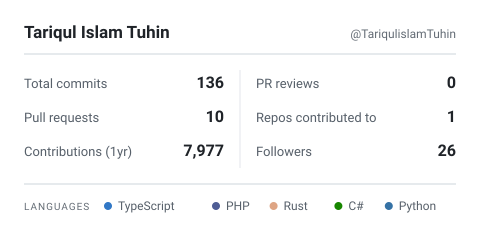

# Tariqul Islam Tuhin

**Full-stack TypeScript engineer** · ERP & fintech at [RedQ Technologies](https://redq.io) · Dhaka, Bangladesh

---

### Now

I lead the finance core of a multi-tenant ERP: double-entry accounting, banking,
billing and payroll, from database schema to API to UI. Next.js 16 monorepo on Bun and
Turborepo, with Drizzle on Postgres and background jobs in a separate worker service.

### Before

Multi-vendor marketplaces and headless storefronts with real-time inventory, vendor
dashboards and GraphQL/REST APIs.
Live demos: [PickBazar](https://pickbazar.redq.io) · [Pixer](https://pixer.redq.io) · [Chawkbazar](https://chawkbazar.redq.io)

> Case studies and full experience → **[Résumé](https://tariqul-islam-tuhin-cv.vercel.app/)**

---

### Open source

| | Contribution | Result |
|---|---|---|
| ✅ merged | [vercel/next.js#95242](https://github.com/vercel/next.js/pull/95242) — Turbopack: dedupe `filename`/`exportedName` in server-reference-manifest | Fixes manifests growing past 170 MB on large App Router apps ([#95239](https://github.com/vercel/next.js/issues/95239)) |
| 🔄 in review | [vercel/next.js#98868](https://github.com/vercel/next.js/pull/98868) — Turbopack: share the server actions loader between pages with the same actions | Max RSS 9.6 GB → 6.6 GB on a 661-page build |

---

### Stack

| | |
|---|---|
| **Languages** | `TypeScript` · `JavaScript` · `PHP` · `SQL` |
| **Frontend** | `Next.js` · `React` · `TailwindCSS` · `shadcn/ui` · `React Hook Form` · `Zod` |
| **Backend** | `Node.js` · `Bun` · `oRPC` · `NestJS` · `Express` · `Laravel` · `GraphQL` · `Better Auth` |
| **Data** | `PostgreSQL` · `Drizzle` · `MySQL` · `Redis` |
| **Tooling & infra** | `Turborepo` · `Docker` · `Kafka` · `RabbitMQ` |

---

